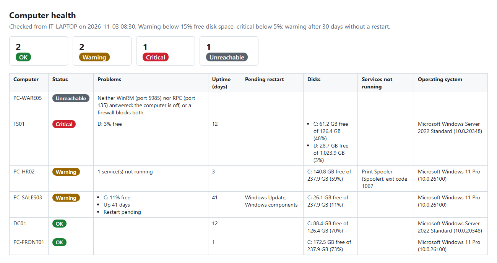
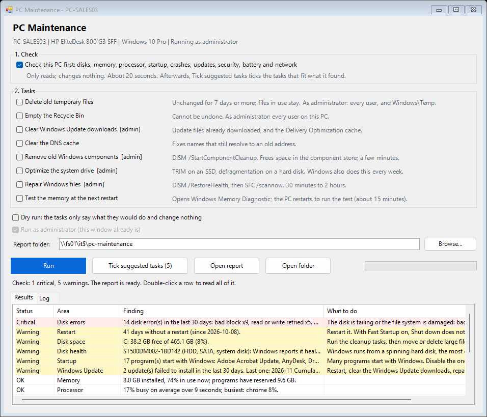
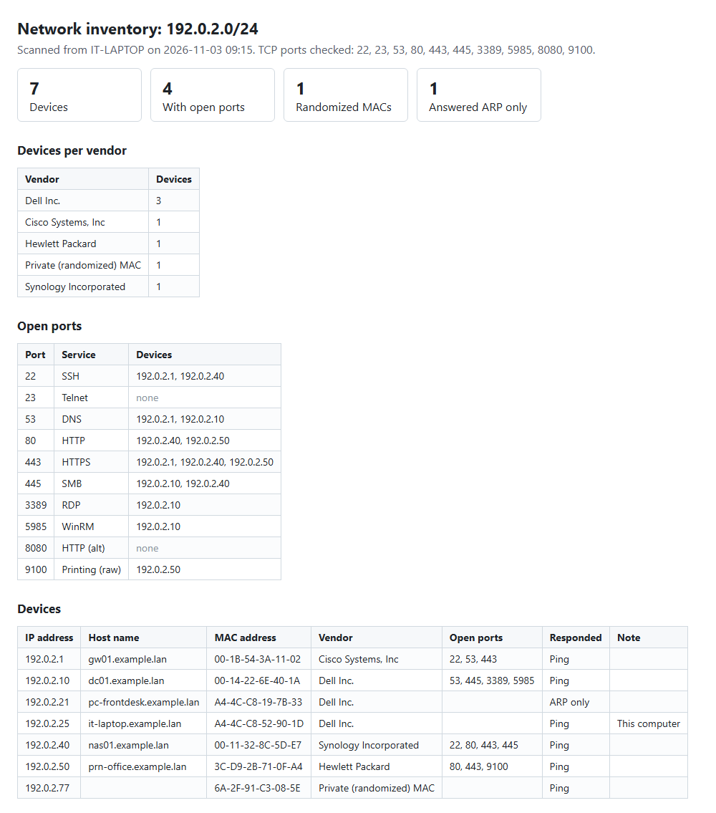
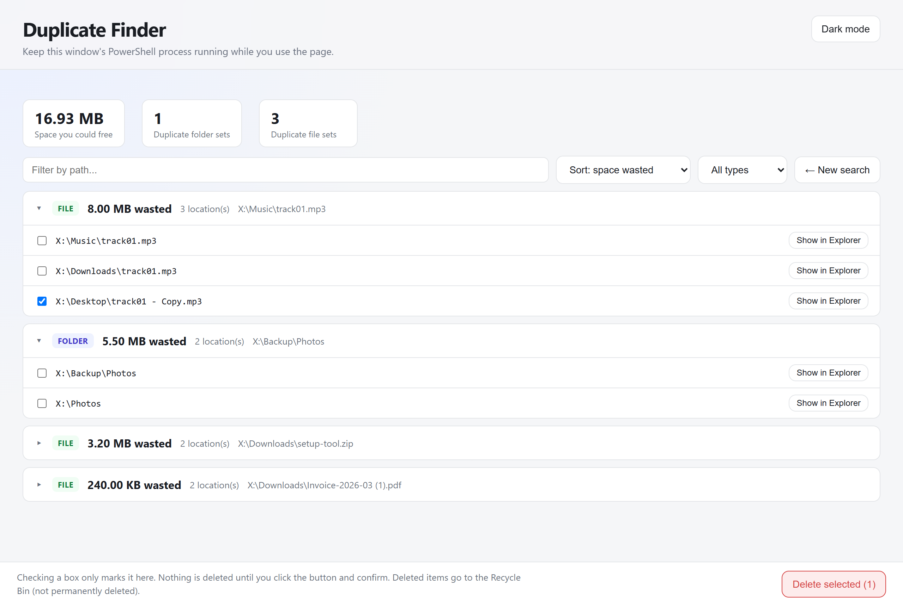

<h1 align="center">PowerShell Tools</h1>

<p align="center">
  PowerShell tools for IT support and Windows administration.<br>
  Each tool has its own README with what it does, what it needs and how to run it.
</p>

<p align="center">
  <a href="https://github.com/johan-socarras/PowerShell-Tools/actions/workflows/powershell-checks.yml"></a>
  <a href="LICENSE"></a>
  
</p>

| Tool | What it does | Windows PowerShell 5.1 | PowerShell 7 | Tested on |
| --- | --- | :---: | :---: | --- |
| [AD User Lifecycle](ad-user-lifecycle) | Onboards and offboards Active Directory users from CSV files | Yes | Not tested | Windows Server 2025 domain controller in my home lab |
| [Computer Health](computer-health) | Reports low disk space, long uptime, pending restarts and stopped services on a list of computers | Yes | Yes | Home lab domain and Windows 11 Pro |
| [PC Maintenance](pc-maintenance) | Finds out why a PC is slow or unstable and runs the usual cleanup and repairs, from a window or the command line | Yes | Yes | Windows 11 Pro |
| [Network Inventory](network-inventory) | Lists every device on a subnet with its vendor and open ports | Yes | Yes | Home lab network and a home network of about 25 devices |
| [GitHub File Distribution](github-file-distribution-docs) | Distributes one update file to many locations and reports who has it | Yes | Yes | End to end against a local stand-in for the GitHub API |
| [Duplicate Finder](duplicate-finder) | Finds duplicate files and folders and removes them through the Recycle Bin | Yes | Yes | Windows 11 |

## Quick start

```powershell
git clone https://github.com/johan-socarras/PowerShell-Tools.git
cd PowerShell-Tools\computer-health
.\Get-ComputerHealth.ps1
```

That checks the computer you are on and writes an HTML report in the current folder. If Windows answers that running scripts is disabled, start it with `powershell -ExecutionPolicy Bypass -File .\Get-ComputerHealth.ps1`. The requirements and examples of each tool are in its folder.

## Tools

### [AD User Lifecycle](ad-user-lifecycle)

New accounts land in their department's OU and group with a temporary password; leavers are disabled, removed from their groups and moved aside. A dry run (`-WhatIf`) shows every change first, and each run writes a report.

### [Computer Health](computer-health)

Writes an HTML report with the computers that need attention first. Connects over CIM (WinRM or DCOM) with nothing to install on them, and exits with an error code for scheduled alerts.

[](computer-health)

### [PC Maintenance](pc-maintenance)

The check covers disk health and errors, memory, processor, startup programs, blue screens and crashes, Windows Update, security software, battery and network, each with what to do. The tasks (temporary files, Recycle Bin, Windows Update cache, DISM and SFC, memory test) have a dry run, and every run writes an HTML report for the ticket.

<p align="center">
  <a href="pc-maintenance"></a>
</p>

### [Network Inventory](network-inventory)

Writes CSV or an HTML report. Discovery runs in parallel and also finds devices that block ping, vendors come from the IEEE list, and nothing on the network is changed.

<p align="center">
  <a href="network-inventory"></a>
</p>

### [GitHub File Distribution](github-file-distribution-docs)

Each location downloads the file, verifies it against a published SHA-256 checksum, replaces its local copy in one step and reports its status to a separate GitHub repository. A second script tells the administrator which locations have the update.

### [Duplicate Finder](duplicate-finder)

A small web server on this computer with a page in the browser. It finds files with identical content and whole duplicate folders, and deletes only through the Recycle Bin, after a confirmation.

[](duplicate-finder)

## Skills Demonstrated

- Active Directory user lifecycle with the ActiveDirectory module, with `-WhatIf` support
- Network discovery: ping sweep, ARP table, MAC vendor lookup and TCP port checks
- Remote health checks over CIM (WinRM and DCOM), including registry reads with StdRegProv
- Windows troubleshooting: event logs, storage reliability counters, Windows Update history, DISM and SFC
- Windows Forms tools that run their work in a separate, elevated process (UAC)
- REST APIs (GitHub Contents API) and a local HTTP server
- File integrity checks (SHA-256) and atomic file replacement
- Unattended runs, safe for Windows Task Scheduler
- Code checks on every change: syntax in Windows PowerShell 5.1 and PowerShell 7, plus PSScriptAnalyzer, in GitHub Actions

## License

[MIT](LICENSE)
