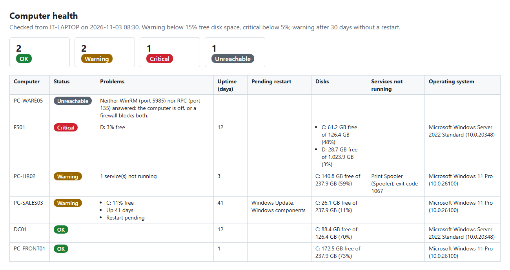

# Computer Health

Checks a list of Windows computers for the problems that usually come before a support ticket: a disk running out of space, weeks without a restart, a restart waiting for updates and services that should be running but are not. Writes an HTML report with the computers that need attention first. Built in PowerShell with CIM, no extra modules.



## What it does

For each computer:

- **Disk space:** free space on every fixed disk. Warning below 15% free, critical below 5%.
- **Uptime:** days since the last restart. Warning after 30 days.
- **Pending restart:** what is waiting for one: Windows Update, Windows components, files to replace at the next start, or a computer rename.
- **Services not running:** automatic services that are stopped. A service that stopped with an error always counts. One that stopped cleanly is skipped when Windows starts it on demand (trigger start) or later (delayed start), or when it is a software updater, since those stop on their own.
- **Status:** OK, Warning, Critical or Unreachable, with the problems in plain words. A computer that cannot be checked says why (for example, the name is not in DNS or both ports are closed).

The report puts Unreachable and Critical computers first. The results also go to the pipeline, and the script exits with code 1 when any computer is Critical or Unreachable, so a scheduled task can raise an alert. It only reads: it restarts or starts nothing.

## Requirements

- Windows PowerShell 5.1 or PowerShell 7, on Windows.
- On the computers checked, nothing to install, but one way in has to be open. The script uses WinRM (port 5985) when it answers and DCOM (RPC, port 135) otherwise:
  - **WinRM:** on by default in Windows Server; on Windows 10/11, `Enable-PSRemoting` or Group Policy turns it on. It needs the computer's name: with an IP address Kerberos cannot be used, so the script falls back to DCOM.
  - **DCOM:** the "Windows Management Instrumentation (WMI)" firewall rules have to be enabled. Without them, the connection times out after 30 seconds and the report says `DCOM: Timed out`.
- An account that is an administrator on the computers checked (in a domain, a member of a group that is). `-Credential` uses another account.

## Usage

```powershell
# This computer
.\Get-ComputerHealth.ps1

# A few computers
.\Get-ComputerHealth.ps1 -ComputerName PC-FRONT01, PC-SALES03, FS01

# A list file (one name per line, # for comments), another account, stricter uptime
.\Get-ComputerHealth.ps1 -ComputerListPath .\computers.txt -Credential (Get-Credential) -UptimeWarningDays 14

# Only the computers that need attention
.\Get-ComputerHealth.ps1 -ComputerListPath .\computers.txt | Where-Object Status -ne 'OK'
```

`-DiskWarningPercent`, `-DiskCriticalPercent` and `-UptimeWarningDays` change the thresholds, and `-ExcludeService` the services to ignore (pass `@()` to see every stopped automatic service). `Get-Help .\Get-ComputerHealth.ps1 -Full` describes every parameter.

## Tested on

- The Active Directory domain in my home lab ([Proxmox-Homelab](https://github.com/johan-socarras/Proxmox-Homelab)), from a Windows Server 2025 domain controller in Windows PowerShell 5.1: the controller itself, a Windows 11 Enterprise workstation over DCOM and over WinRM (results checked against the workstation's own registry and services), the same workstation without admin rights (access denied) and with the WMI firewall rules off (time-out), a firewall appliance with both ports closed and a name not in DNS.
- Windows 11 Pro, in both Windows PowerShell 5.1 and PowerShell 7.6: the computer itself, the same computer reached by its IP address over DCOM (the network path, not the local one), a name not in DNS, a host with WinRM and RPC closed, a list file, forced disk thresholds, the exit codes, and the input checks (missing or empty list, thresholds the wrong way round, missing report folder). Results checked against the registry and `Get-CimInstance` on the same computer.
