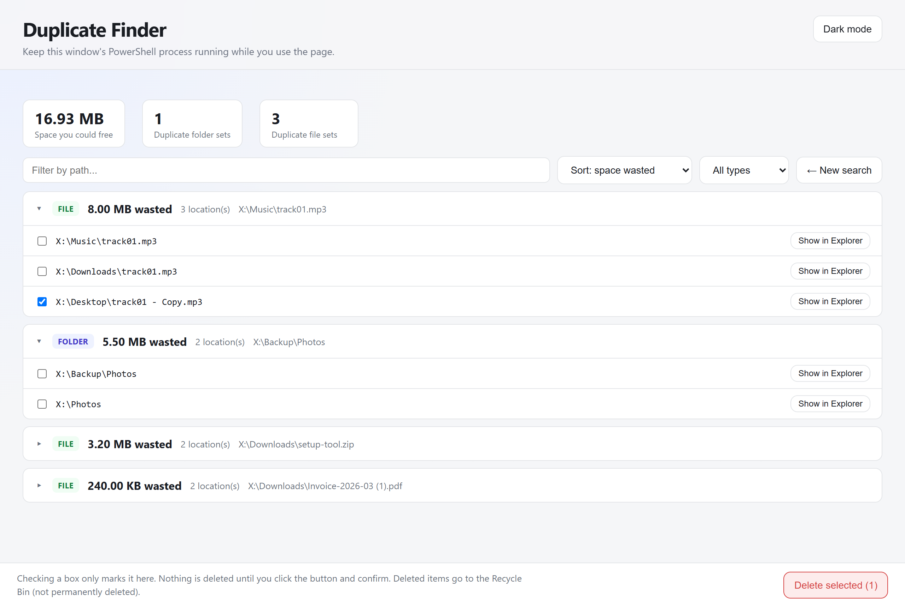

# Duplicate File Finder

A local web app for finding and safely removing duplicate files and folders on Windows, built entirely in PowerShell — no installs, no external dependencies.

*Scan results on sample data.*

## What it does

- Scans chosen folders, drives, or individual files for duplicates with identical content (same size and MD5 hash).
- Detects whole duplicate folders (not just individual files) — e.g. a backup copy of an entire folder tree — and reports it as one entry instead of one line per file inside it.
- Lets you add a specific folder or file through Browse; each selection remains clearly listed before the scan starts.
- Runs as a small local web app: a PowerShell HTTP server on localhost, with an interactive page in your browser.
- Deleting always goes through the Windows Recycle Bin (reversible) and always requires an explicit checkbox selection plus confirmation — nothing is ever deleted automatically.

## Requirements

- Windows with PowerShell (tested on Windows PowerShell 5.1 and PowerShell 7).
- No installs, no admin rights needed.

## Usage

    powershell -ExecutionPolicy Bypass -File .\duplicate_finder_app.ps1

This opens http://localhost:8791/ in your default browser. Keep the PowerShell window open while using the page — it's the engine behind it. Close the window to stop the server.

## Features

- Scan for duplicates — pick preset folders (Desktop, Downloads, Documents, Pictures, and more) or use Browse to add any folder, drive, or individual file.
- Results view — grouped by duplicate set, sortable by space wasted / number of copies / path, filterable by text or type (folder vs. file).
- Delete — check the copies you want to remove (at least one copy must stay unchecked, so you can't remove every copy), click delete, confirm — items go to the Recycle Bin.
- Show in Explorer — jump straight to a file or folder's location in File Explorer instead of just copying the path.

## Safety notes

- Never deletes permanently — everything goes through the Recycle Bin and can be restored.
- Never opens or downloads OneDrive cloud-only files: they are skipped, and a folder that contains one is never reported as a duplicate folder.
- Nothing is deleted without an explicit checkbox selection and a confirmation click.
- The local server only answers its own page: each run creates a random session token, and requests without it, or from another website, are rejected.
