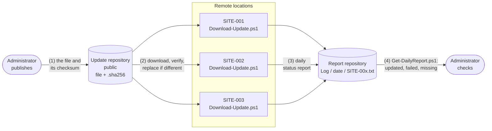

[← All tools](https://github.com/johan-socarras/PowerShell-Tools#tools)

# GitHub File Distribution

Distributes one update file, such as a price list, a product catalog or a configuration file, from GitHub to many remote locations, and tells the administrator which locations have it. Built in PowerShell with the GitHub REST API, no extra modules.



## What it does

- **`scripts/Download-Update.ps1`**, at each location, by hand or from Windows Task Scheduler: downloads the update file and its `.sha256` checksum, verifies the download against the checksum before touching anything, and replaces the local copy in one step only when the file changed. Then it writes the location's status for the day to the report repository, in `Log/<date>/<SiteID>.txt`. A report that cannot be sent is kept and sent on the next run.
- **`scripts/Get-DailyReport.ps1`**, for the administrator: reads the day's reports, checks each one's `SiteID` and `Status` against the list of expected locations, and lists the locations that did not report and those that reported a failure. It exits with code 1 until every location has the file, so a scheduled run can raise an alert.

The statuses a location can report:

```text
File Updated Successfully
File Already Updated
Download Failed
Remote File Missing
Checksum Validation Failed
Local File Update Failed
```

A report file:

```text
SiteID: SITE-001
Status: File Updated Successfully
Timestamp: 2026-06-30T17:30:00.0000000-05:00
```

## Requirements

- Windows PowerShell 5.1 or PowerShell 7, on Windows, and internet access at each location.
- Two GitHub repositories: a public one for the update file, which the locations download without a token, and a separate one for the reports.
- A token that can only write to the report repository (a fine-grained token with Contents: Read and write on that repository alone), in the `GITHUB_TOKEN` environment variable of each location.

## Configuration

Both scripts have a CONFIGURATION section at the top. At each location, `Download-Update.ps1` needs its own `$SiteID`, the `$DownloadUrl` of the update file and the report repository (`$RepoOwner`, `$RepoName`); `Get-DailyReport.ps1` needs the same repository and the list of expected locations. The scripts stop while any of these still has its example value. Every setting, and how to publish the checksum, is in [docs/CONFIGURATION.md](docs/CONFIGURATION.md).

## Usage

```powershell
# At each location (add -PauseAtEnd to read the output when started by double-click)
.\scripts\Download-Update.ps1

# From the administrator's computer: today's reports, or another day's
.\scripts\Get-DailyReport.ps1
.\scripts\Get-DailyReport.ps1 -ReportDate 2026-06-30
```

## Sample output

The daily report for five locations (sample data): three updated, one sent nothing and one reported a failed checksum. A location without a report usually has no internet access or did not run its scheduled task; it sends its report on its next run.

```text
Daily report: 2026-06-30
Successful locations: 3/5

NO REPORT RECEIVED:
 - SITE-004

REPORTED FAILURE:
 - SITE-005: Checksum Validation Failed [2026-06-30T06:04:27.0000000-05:00]

Do not remove the update file until all locations report a successful status.
```

## Security

- Keep the token out of the scripts. If one is ever committed, revoke it in GitHub, create a new one and update the `GITHUB_TOKEN` variable at the locations.
- The update repository is public, because the download sends no token: do not distribute confidential data this way.
- The checksum catches a corrupted or incomplete download. It does not stop someone who can change both the file and its checksum, so protect the branch that hosts the update file, and never give the locations write access to the update repository.

## Tested on

Windows 11, in Windows PowerShell 5.1 and PowerShell 7, against a local stand-in for the GitHub API: a new update file, the same file again, a wrong checksum, and reports kept while the connection was down and sent once it came back. The daily report, with the five sample locations above.
