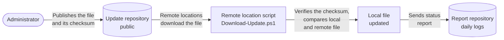
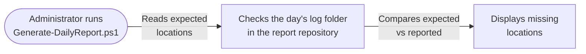

# Workflow

## File Distribution Workflow

## Daily Reporting Workflow

## Example Daily Process

1. Publish the new update file and its checksum in the update repository.
2. Wait for all remote locations to run the download script.
3. Run the daily report script.
4. Review missing locations.
5. If all locations reported, the update was successfully distributed.
6. If some locations are missing, check internet access or script execution at those locations.

## When Not All Locations Report

If one or more locations do not report:

- do not delete the current update file yet
- verify internet access at the missing locations
- confirm the scheduled task or script ran correctly
- check whether pending reports exist locally
- run the report again after the missing locations retry

