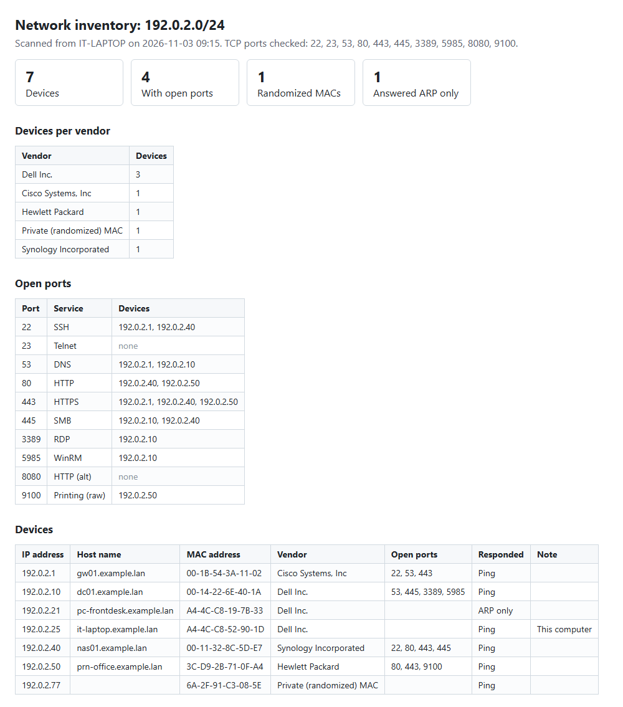

[← All tools](https://github.com/johan-socarras/PowerShell-Tools#tools)

# Network Inventory

Finds every device on an IPv4 subnet and lists its IP address, host name, MAC address, vendor and open ports, in a CSV file, an HTML report or both. Built in PowerShell with .NET networking classes, no extra modules.



## What it does

- **Discovery:** pings every address in the subnet at once, so a /24 takes seconds, not minutes. Devices that block ping but answer ARP (Windows PCs with the default firewall, for example) are found too and marked `ARP only`.
- **Host names:** reverse DNS lookup for each device.
- **MAC address and vendor:** read from the Windows neighbor (ARP) table and matched against the IEEE list of MAC address blocks. Private (randomized) MAC addresses, used by phones and laptops, are labeled as such.
- **Open ports:** checks a short list of TCP ports that matter in support work (SSH, Telnet, DNS, HTTP, HTTPS, SMB, RDP, WinRM, 8080 and raw printing on 9100). `-Port` changes the list.
- **Hints:** one MAC address on several IP addresses (one device with two addresses, or an address conflict) is pointed out in the `Note` column.
- **Report:** CSV for Excel or further scripts, HTML for people, with totals, devices per vendor and which devices have each port open.

It only reads: nothing on the network or on the devices is changed.

## Requirements

- Windows 10/11 or Windows Server, with Windows PowerShell 5.1 or PowerShell 7.
- To see MAC addresses and vendors, run it from a computer on the subnet you scan: behind a router, Windows only sees the router. From another subnet you still get addresses, names and ports.
- Internet access once, to download the IEEE vendor list (about 5 MB, kept next to the script as `oui.csv`). MAC addresses are never sent anywhere.

## Usage

```powershell
# First run: download the vendor list, then scan
.\Get-NetworkInventory.ps1 -Subnet 192.0.2.0/24 -UpdateVendorList

# HTML report
.\Get-NetworkInventory.ps1 -Subnet 192.0.2.0/24 -Format Html

# CSV and HTML, only SSH and HTTPS, in another folder
.\Get-NetworkInventory.ps1 -Subnet 192.0.2.0/24 -Port 22, 443 -Format Both -OutputFolder C:\Reports

# Only find the devices, no port checks
.\Get-NetworkInventory.ps1 -Subnet 192.0.2.0/24 -SkipPortScan
```

Subnets from /22 (1,022 addresses) to /32 are accepted; split a larger range and scan it in parts. `Get-Help .\Get-NetworkInventory.ps1 -Full` describes every parameter.

## Sample output

The CSV has one row per device (sample data):

```text
"IPAddress","HostName","MacAddress","Vendor","OpenPorts","Responded","Note"
"192.0.2.1","gw01.example.lan","00-1B-54-3A-11-02","Cisco Systems, Inc","22, 53, 443","Ping",""
"192.0.2.10","dc01.example.lan","00-14-22-6E-40-1A","Dell Inc.","53, 445, 3389, 5985","Ping",""
"192.0.2.21","pc-frontdesk.example.lan","A4-4C-C8-19-7B-33","Dell Inc.","","ARP only",""
"192.0.2.25","it-laptop.example.lan","A4-4C-C8-52-90-1D","Dell Inc.","","Ping","This computer"
"192.0.2.40","nas01.example.lan","00-11-32-8C-5D-E7","Synology Incorporated","22, 80, 443, 445","Ping",""
"192.0.2.50","prn-office.example.lan","3C-D9-2B-71-0F-A4","Hewlett Packard","80, 443, 9100","Ping",""
"192.0.2.77","","6A-2F-91-C3-08-5E","Private (randomized) MAC","","Ping",""
```

The objects are also written to the pipeline, so the results can be filtered on the spot:

```powershell
.\Get-NetworkInventory.ps1 -Subnet 192.0.2.0/24 | Where-Object OpenPorts -match '3389'
```

## Notes

- Scan only networks you own or are allowed to scan. Port checks are plain TCP connections, but security tools may still flag them.
- A device that is asleep or off is not found, and one that blocks ping is only found from its own network segment, through ARP. Run it again at another time of day for a fuller picture.
- Re-run with `-UpdateVendorList` now and then to pick up new vendors.

## Tested on

- The isolated lab network of my home lab ([Proxmox-Homelab](https://github.com/johan-socarras/Proxmox-Homelab)), from a Windows Server 2025 domain controller in Windows PowerShell 5.1: vendor list download, the firewall appliance and a Windows 11 workstation found through ARP although both block ping, open ports, CSV and HTML reports, and a subnet the server is not on.
- Windows 11 Pro on a /24 home network with about 25 devices, in both Windows PowerShell 5.1 and PowerShell 7.6: discovery including devices that only answer ARP, vendors, randomized MAC addresses, open ports, CSV and HTML reports, a subnet the computer is not on, and the input checks (subnet too large, invalid subnet, missing output folder).
