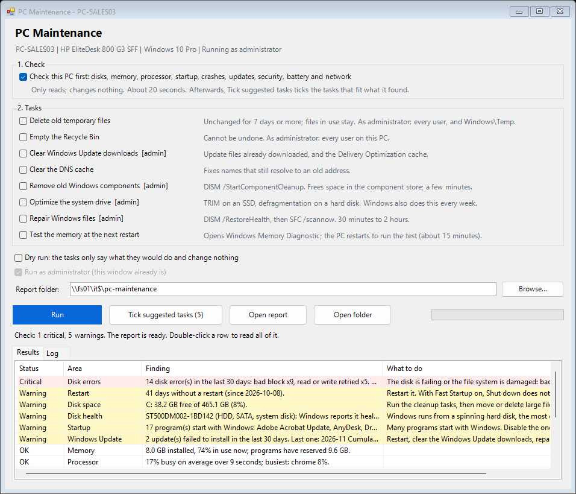
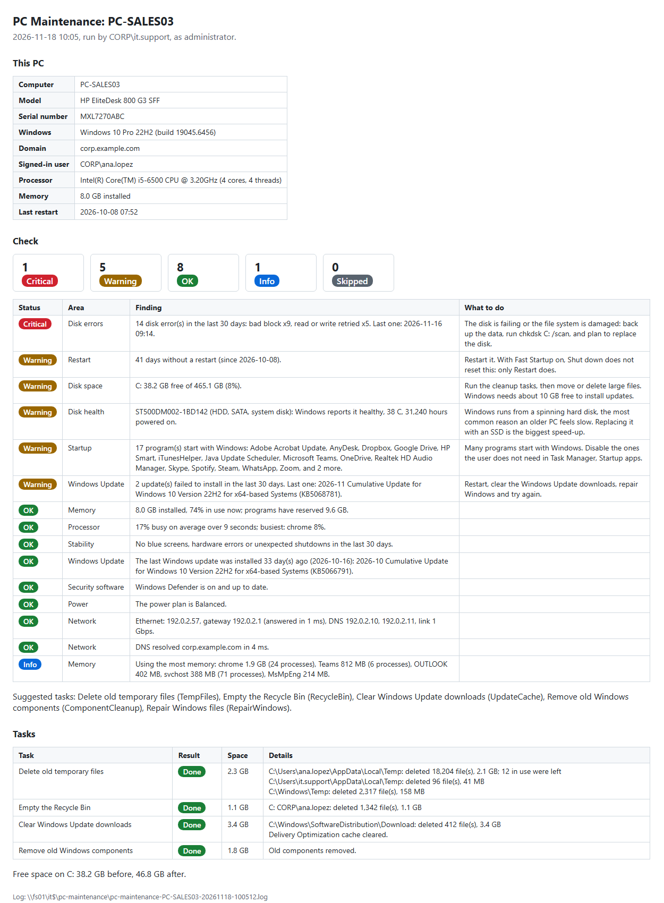

[← All tools](https://github.com/johan-socarras/PowerShell-Tools#tools)

# PC Maintenance

Finds out why a Windows PC is slow or unstable, runs the usual cleanup and repair steps, and writes an HTML report to attach to the ticket. A window for the technician sitting at the PC, or the command line for a remote session or a management tool. Built in PowerShell with Windows Forms and CIM, no extra modules.



## What it does

### Check

Reads only. Each finding gets a status (Critical, Warning, OK, Info or Skipped) and what to do about it.

- **Restart:** days since the last restart and whether one is pending (Windows Update, Windows components, files to replace, a computer rename).
- **Disk space:** free space on every fixed disk. Warning below 15% (or 10 GB on the system drive), critical below 5% (or 5 GB).
- **Disk health:** what Windows reports for each physical disk and, as administrator, wear, read errors it could not correct, temperature, hours powered on and SMART failure prediction. A spinning hard disk as the system disk is pointed out: it is the most common reason an older PC feels slow.
- **Disk errors:** bad blocks, paging errors, file system damage and controller resets in the System log.
- **Memory:** installed, in use and reserved by programs, and the five programs that use the most.
- **Processor:** load over about ten seconds and the programs keeping it busy.
- **Startup:** the programs that start with Windows (the enabled ones, as Task Manager shows them) and, as administrator, how long the last full startup took.
- **Stability:** blue screens with their stop code, unexpected shutdowns, hardware (WHEA) errors, the result of the last memory test and the programs that crash most.
- **Windows Update:** when the last Windows update installed, updates that failed and have not installed since, and a disabled update service.
- **Windows image:** as administrator, `DISM /CheckHealth` (it only reads, and takes a second): a damaged image suggests the repair.
- **Security software:** no antivirus on, two at once, or old definitions.
- **Battery:** on laptops, how much charge it holds compared with new.
- **Power plan:** the Power saver plan slows the processor down.
- **Network:** each connected adapter with its address, gateway (and whether it answers), DNS servers and link speed (a wired link at 100 Mbps or less is pointed out), and whether DNS resolves the domain, or `www.microsoft.com` outside a domain.

Some findings suggest tasks: low disk space suggests the cleanups, blue screens suggest the memory test and the repair. In the window, **Tick suggested tasks** ticks them; nothing runs until you click **Run**.

### Tasks

| Task | What it does | Administrator |
| --- | --- | :---: |
| `TempFiles` | Deletes temporary files unchanged for 7 days or more (`-TempFileAgeDays`). As administrator, for every user profile and `Windows\Temp`; otherwise, for the current user. | No |
| `RecycleBin` | Empties the Recycle Bin on every fixed drive. As administrator, every user's. | No |
| `UpdateCache` | Clears downloaded Windows Update files and the Delivery Optimization cache. Stops Windows Update and BITS while it deletes and starts them again; waits if Windows Update is waiting for a restart. | Yes |
| `DnsCache` | Clears the DNS client cache. | No |
| `ComponentCleanup` | Removes superseded Windows components (`DISM /StartComponentCleanup`). | Yes |
| `OptimizeDrive` | Optimizes the system drive: TRIM on an SSD, defragmentation on a hard disk. | Yes |
| `RepairWindows` | Repairs the Windows image with `DISM /RestoreHealth`, then system files with `SFC /scannow`, in that order. If DISM finds no repair source, as on PCs that update from WSUS, it says how to use a Windows ISO instead. Expect 30 minutes to two hours, most of it SFC: the other tasks together take a few minutes. The log shows their progress every 10%. | Yes |
| `MemoryTest` | Opens Windows Memory Diagnostic, where you choose to restart now or at the next start. The next check shows the result. | No |

Tasks always run in this order. Deletions skip files in use and never follow a junction or symbolic link out of the folder being cleaned. With **Dry run** (`-DryRun`) every task says what it would do, and how much it would free, and nothing is changed. Without it, the window asks for confirmation before any task that changes the PC.

### Report

Every run writes an HTML report (the PC, the findings with the worst first, the tasks and the space they freed) and a log; `-JsonPath` adds a JSON copy. The script exits with code 1 when a check is Critical or a task failed, 2 when the parameters are wrong, and 0 otherwise.

[](report.png)

## Requirements

- Windows 10 or 11 with Windows PowerShell 5.1 or PowerShell 7. Nothing to install.
- Administrator rights for the tasks marked Yes above, the disk counters, the startup time and the Windows image. Without them those say Skipped and the rest runs. In the window, **Run as administrator** makes Windows ask for permission (UAC) when you click Run.
- For a report folder on a network share, use its UNC path (`\\server\share`). An elevated process does not see the drive letters mapped by the user; the window changes a mapped letter into its UNC path by itself.

## Usage

**The window:** double-click `Start-PCMaintenance.cmd` (keep it next to the script), or:

```powershell
powershell -NoProfile -ExecutionPolicy Bypass -STA -File .\Invoke-PCMaintenance.ps1
```

**The command line:**

```powershell
# Check this PC; the report goes to the current folder
.\Invoke-PCMaintenance.ps1 -Check

# How much the cleanups would free, without deleting anything
.\Invoke-PCMaintenance.ps1 -Check -Task TempFiles, RecycleBin, UpdateCache, ComponentCleanup -DryRun

# Clean up, with the report on a share
.\Invoke-PCMaintenance.ps1 -Task TempFiles, RecycleBin, UpdateCache -ReportPath \\fs01\it$\reports\PC-SALES03.html

# Only what needs attention
(.\Invoke-PCMaintenance.ps1 -Check -PassThru).Findings | Where-Object Status -in 'Critical', 'Warning'
```

`-UptimeWarningDays` and `-EventDays` change how long without a restart is a warning (30 days) and how far back the event logs are read (30 days). `Get-Help .\Invoke-PCMaintenance.ps1 -Full` describes every parameter.

## Tested on

- Windows 11 Pro (build 26300), in Windows PowerShell 5.1 and PowerShell 7.7, with and without administrator rights:
  - The full check, against the PC's own event logs, update history, registry and disks. Real findings included a pending file rename, corrected hardware errors, an update that failed and installed later (correctly not reported as failed) and, as administrator, a Windows image that DISM reports as repairable, along with the wear and temperature of four disks and the startup time.
  - Every task except the Recycle Bin for real, as administrator, on that same PC: 1.9 GB of old temporary files deleted from the user profile and `Windows\Temp`, the Windows Update downloads and the Delivery Optimization and DNS caches cleared, superseded components removed, the SSD trimmed, and the damaged Windows image repaired by `DISM /RestoreHealth`, after which `SFC /scannow` found no damaged files. The other tasks took 5 minutes, DISM 14 and SFC 99.
  - Every task in dry run: as administrator, the temporary files of every profile and `Windows\Temp`, the Windows Update downloads, the component store analysis and the DISM quick check; without, the administrator tasks skipped.
  - How the Windows image check reads each DISM answer, including one in another language.
  - The deletion code in a test folder: old, recent, read-only and locked files, empty folders, the `desktop.ini` of a Recycle Bin, and a junction pointing outside the folder, whose target was left untouched.
  - The input checks and exit codes.
  - The window, driven from code: Run, the results list, the log, Tick suggested tasks and the saved report folder.
